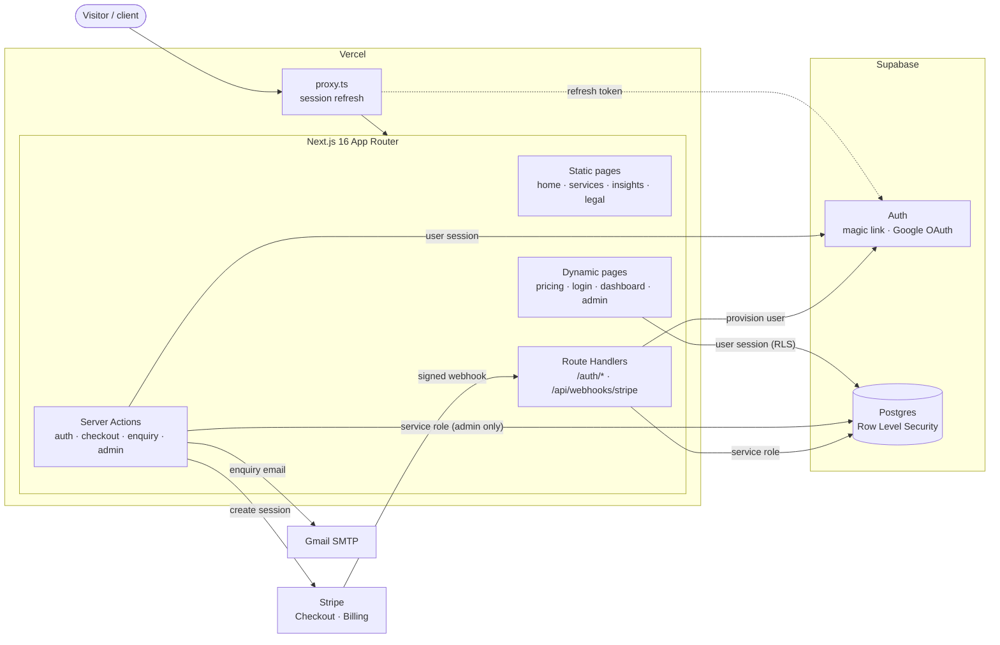
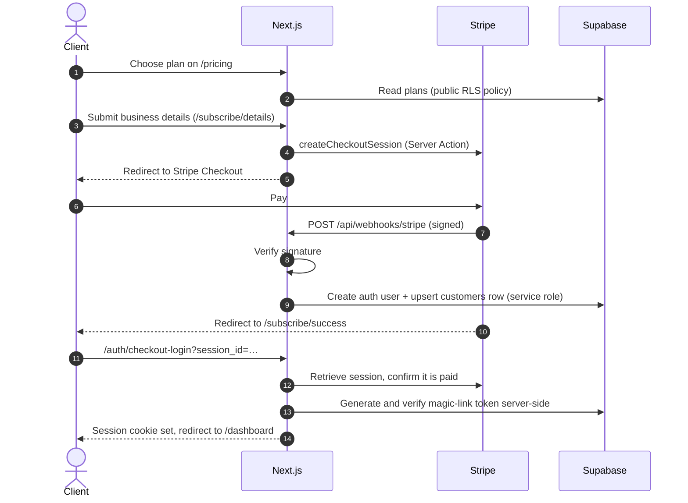
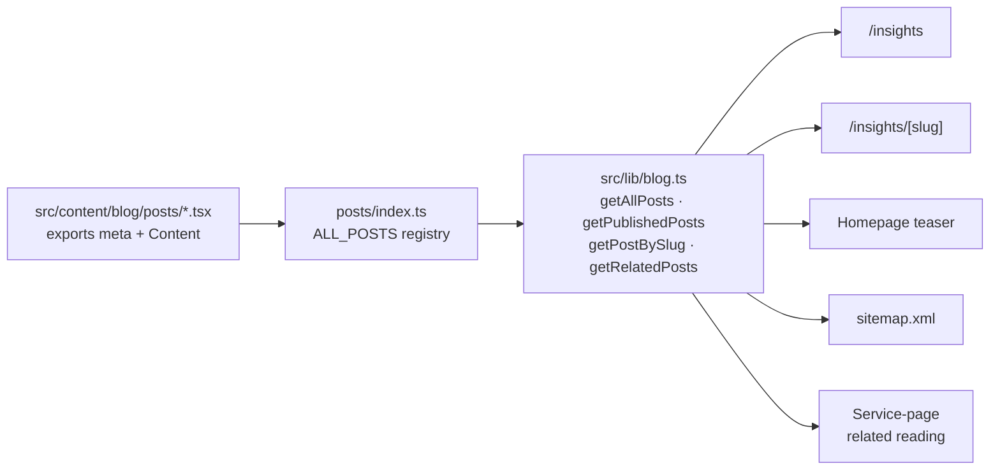
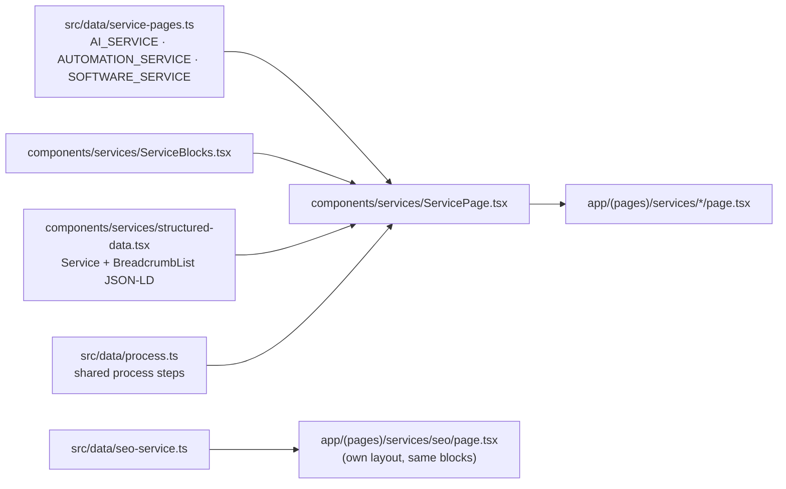
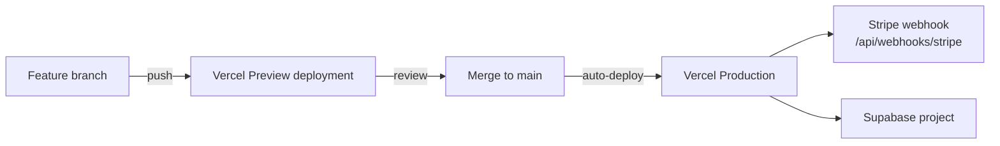

<div align="center">


# Chinvat Bridge

**The website and client platform for Chinvat Bridge, a UK-based technology consultancy for AI integration, workflow automation, custom software and technical SEO.**

[](https://nextjs.org)
[](https://react.dev)
[](https://www.typescriptlang.org)
[](https://tailwindcss.com)
[](https://supabase.com)
[](https://stripe.com)
[](https://threejs.org)
[](https://playwright.dev)
[](https://pnpm.io)
[](https://vercel.com)

[Live site](https://www.chinvatbridge.com) · [Architecture](#architecture) · [Local development](#local-development) · [Deployment](#deployment-on-vercel)

</div>

---

## Contents

- [Overview](#overview)
- [Technology stack](#technology-stack)
- [Capabilities](#capabilities)
- [Architecture](#architecture)
- [Repository structure](#repository-structure)
- [Routing and rendering](#routing-and-rendering)
- [Insights: articles and content](#insights-articles-and-content)
- [Service pages](#service-pages)
- [Supabase integration](#supabase-integration)
- [Authentication and security](#authentication-and-security)
- [Local development](#local-development)
- [Environment variables](#environment-variables)
- [Testing, linting and building](#testing-linting-and-building)
- [Deployment on Vercel](#deployment-on-vercel)
- [Contributing](#contributing)

---

## Overview

This repository is the whole of [chinvatbridge.com](https://www.chinvatbridge.com): the marketing site, the Insights articles, the service pages, SEO subscription checkout, and a signed-in area for clients and administrators.

It is a single **Next.js 16 App Router** application written in TypeScript. **Supabase** provides Postgres and authentication, **Stripe** handles subscription billing, and **Vercel** hosts it. Most public pages are rendered at build time. Only routes that read a session, the database or a payment run on the server for each request.

> [!NOTE]
> This project uses Next.js 16, which renames `middleware.ts` to **`proxy.ts`** and changes some APIs. Read the guides in `node_modules/next/dist/docs/` before changing framework-level code. See [`AGENTS.md`](AGENTS.md).

---

## Technology stack

| Layer | Technology | Notes |
| :-- | :-- | :-- |
| Framework | [Next.js](https://nextjs.org) `16.4.5` (App Router) | Server Components, Server Actions, Route Handlers, `proxy.ts` |
| UI runtime | [React](https://react.dev) `19.2.8` | |
| Language | [TypeScript](https://www.typescriptlang.org) `5.9` | `strict` mode, `@/*` path alias to `src/*` |
| Styling | [Tailwind CSS](https://tailwindcss.com) `4.3` | Design tokens in `src/styles/tokens.css`, PostCSS plugin |
| UI primitives | [Radix UI](https://www.radix-ui.com) `1.8.1`, `class-variance-authority`, `tailwind-merge` | shadcn-style components in `src/components/ui` |
| 3D | [three.js](https://threejs.org) `0.186.1` | Loaded on demand; never in the initial bundle |
| Database and auth | [Supabase](https://supabase.com): `@supabase/supabase-js` `2.116`, `@supabase/ssr` `0.12` | Postgres with Row Level Security, magic-link and Google sign-in |
| Payments | [Stripe](https://stripe.com) Node SDK `22.6` | Checkout Sessions (subscriptions) and signed webhooks |
| Email | [Nodemailer](https://nodemailer.com) `10.3` | Contact enquiries sent over Gmail / Google Workspace SMTP |
| Testing | [Playwright](https://playwright.dev) `1.64`, Node's built-in test runner | End-to-end tests at three viewports, plus unit tests |
| Linting | ESLint `9` with `eslint-config-next` | Core Web Vitals and TypeScript rule sets |
| Fonts | Archivo and Martian Mono (self-hosted, OFL) | `src/styles/fonts/` |
| Package manager | [pnpm](https://pnpm.io) `11.7.0` | Pinned through `packageManager` |
| Hosting | [Vercel](https://vercel.com) | |

---

## Capabilities

| Area | What it does | Status |
| :-- | :-- | :-- |
| **Homepage** | Hero, services, work, approach, capabilities, about, an Insights teaser and a contact conversation, with WebGL scenes that fall back to static images | Live |
| **Service pages** | Pages for AI integration, workflow automation, custom software and SEO, each with schema.org `Service` and `BreadcrumbList` data | Live |
| **Insights** | Articles written as React components, with a draft workflow, related reading, `Article` structured data and sitemap entries | Live (some articles are still drafts) |
| **Contact conversation** | A step-by-step enquiry form, sent by email by a Server Action, with spam guards | Live |
| **SEO pricing and checkout** | Plans read from Supabase, a business-details step, and a Stripe Checkout subscription | Implemented |
| **Account provisioning** | A Stripe webhook creates the client's Supabase account and customer record, and keeps subscription status in sync | Implemented |
| **Client dashboard** | Signed-in view of the client's engagement, project progress, sprint items and updates | Partial: report downloads and call scheduling are marked *coming soon* |
| **Admin area** | An allow-listed area for viewing customers and editing their engagement details, progress and sprint items | Implemented (internal) |
| **Client portal preview** | A public demo of the portal at `/client-portal`, using illustrative example data only | Preview |
| **SEO foundations** | Canonical URLs, Open Graph and Twitter metadata, JSON-LD, `sitemap.xml`, `robots.txt`, optional search-engine verification tags | Live |
| **Design studies** | Internal design-review pages (`/bridge-studies`, `/hero-studies/*`) | Development only: they return a 404 in production |

---

## Architecture



**Ways in.** Every page request (except static assets and `/api/*`) passes through `src/proxy.ts`, which refreshes the Supabase session cookie. Pages and Server Actions use a Supabase client tied to the request, so Row Level Security applies to the signed-in user. Only server code that cannot act as the user (the Stripe webhook and admin actions) uses the service-role client.

### Subscription and onboarding flow



Later billing events (`invoice.payment_failed`, `customer.subscription.deleted`) update the customer's `status` to `past_due` or `cancelled` through the same webhook.

---

## Repository structure

```text
.
├── src/
│   ├── app/                     # App Router: routes, layouts, metadata files
│   │   ├── (site)/              # Homepage and dev-only design studies
│   │   ├── (pages)/             # Inner pages: services, insights, pricing, legal, auth, portals
│   │   ├── api/webhooks/stripe/ # Stripe webhook Route Handler
│   │   ├── auth/                # OAuth / magic-link callback, post-checkout login
│   │   ├── layout.tsx           # Root layout, global metadata, Organization JSON-LD
│   │   ├── sitemap.ts           # Generated sitemap.xml
│   │   └── robots.ts            # Generated robots.txt
│   ├── actions/                 # Server Actions: auth, checkout, enquiry, admin
│   ├── components/
│   │   ├── home/                # Homepage sections
│   │   ├── services/            # Shared service-page template and blocks
│   │   ├── insights/            # Article index and article footer
│   │   ├── three/               # WebGL runtime, scenes, materials (see its README)
│   │   ├── system/              # Layout and typography primitives
│   │   ├── site/                # Header, footer, navigation, mobile menu
│   │   ├── organisms/ portal/   # Pricing, checkout, dashboard and admin UI
│   │   └── ui/                  # Radix-based primitives
│   ├── content/blog/posts/      # Insights articles (one .tsx per article) and registry
│   ├── data/                    # Typed content: services, service pages, process, pricing
│   ├── lib/                     # Supabase clients, Stripe, metadata, blog helpers, curves
│   ├── styles/                  # Tokens, base, prose, motion CSS and self-hosted fonts
│   └── proxy.ts                 # Next.js 16 proxy (formerly middleware)
├── supabase/
│   ├── migrations/              # SQL schema and RLS policies
│   └── config.toml              # Supabase CLI project config
├── tests/
│   ├── e2e/                     # Playwright specs
│   └── unit/                    # node:test specs
├── scripts/                     # QA screenshots, data generation, SEO checks, brand assets
├── public/                      # Static assets
├── docs/ reference/ prototypes/ # Design specs, references and design prototypes
├── seo/                         # SEO research and planning documents
├── next.config.ts               # Redirects and security headers
├── playwright.config.ts
└── .env.example                 # Environment variable template (no values)
```

---

## Routing and rendering

Two **route groups** share the root layout. They organise the code without changing URLs:

- **`(site)`**: the homepage, plus design-review pages that return a 404 in production builds.
- **`(pages)`**: every inner page. It applies the same self-hosted fonts and body scope.

| Route | Rendering | Purpose |
| :-- | :-- | :-- |
| `/` | Static | Homepage |
| `/services/ai-integration`, `/services/workflow-automation`, `/services/custom-software`, `/services/seo` | Static | Service pages |
| `/insights` | Static | Article index (published articles only) |
| `/insights/[slug]` | SSG (`generateStaticParams`) | Individual articles |
| `/privacy`, `/terms` | Static | Legal pages |
| `/client-portal` | Static | Portal preview with example data (`noindex`) |
| `/pricing` | Dynamic | SEO plans loaded from Supabase |
| `/subscribe/details`, `/subscribe/success`, `/subscribe/error` | Dynamic | Checkout steps |
| `/login` | Dynamic | Magic-link and Google sign-in (`noindex`) |
| `/dashboard` | Dynamic | Signed-in client dashboard (`noindex`) |
| `/admin`, `/admin/customers/[id]` | Dynamic | Admin area (`noindex`) |
| `/auth/callback`, `/auth/checkout-login` | Route Handler | Session exchange and post-checkout login |
| `/api/webhooks/stripe` | Route Handler | Stripe events |
| `/sitemap.xml`, `/robots.txt`, `/opengraph-image.png` | Static | Metadata routes |

`/services` permanently redirects to `/#services` (configured in `next.config.ts`).

**Metadata.** The root layout sets `metadataBase`, the title template, the default Open Graph and Twitter fields, and the `Organization` / `WebSite` JSON-LD graph. Inner pages call `pageMetadata()` from `src/lib/metadata.ts`, so every page sets its own canonical URL and full social metadata instead of inheriting the homepage's.

**3D scenes.** WebGL stages in `src/components/three` load three.js with dynamic `import()` only when the stage scrolls into view. They fall back to server-rendered posters when WebGL 2 is unavailable or the visitor prefers reduced motion.

---

## Insights: articles and content

Articles live in the repository as typed React modules. There is no CMS.



Each article exports a `meta` object (`PostMeta`) and a `Content` component:

```tsx
import type { PostMeta } from "@/lib/blog";

export const meta: PostMeta = {
  slug: "example-article",
  title: "Example article heading",
  seoTitle: "Shorter search title",   // optional
  description: "One-sentence summary used for meta description and listings.",
  date: "2026-01-01",                 // first published (YYYY-MM-DD)
  updated: "2026-02-01",              // optional: only when actually revised
  author: "Chinvat Bridge",
  category: "AI & Workflows",
  tags: ["ai"],
  readingMinutes: 6,
  draft: true,                        // optional: hidden in production
};

export function Content() {
  return <p>Article body…</p>;
}
```

**Adding an article.** Create the file in `src/content/blog/posts/`, then add one import and one entry to `ALL_POSTS` in `posts/index.ts`. The registry is an explicit import list rather than a directory scan, so the bundler always includes exactly the articles that exist.

**Drafts.** Articles with `draft: true` are:

- left out of production builds, the sitemap and static params;
- readable under `next dev` at their own URL, labelled as drafts, for review in place;
- never listed in `/insights` or the homepage teaser, even in development;
- marked `noindex, nofollow` as an extra safeguard.

To publish, remove `draft` and set `date` to the publishing day. Service pages link to related articles by slug, and unpublished slugs are skipped automatically, so an article appears on its service page the day it goes live.

**Per-article output.** Each article page generates canonical and Open Graph `article` metadata, plus `Article` and `BreadcrumbList` JSON-LD tied to the site's `Organization` node.

---

## Service pages

The AI, automation and software pages share one template, and all of their content lives in typed data:



- **`ServicePageContent`** describes a page completely: path, title and description, H1 and lede, problems, offerings, examples, approach, notes for each process step, engagement model, FAQs, related articles and related services, and the closing call to action.
- Each route file is a few lines long. It exports `serviceMetadata(content)` and renders `<ServicePage content={…} />`.
- **SEO** keeps its own data module and page because it has published plans on `/pricing`. The other services are quoted per project, so their calls to action open the homepage contact conversation.
- Every service page appears in the sitemap with its own `updated` date as `lastModified`.

**Adding a service page:** add a `ServicePageContent` object to `src/data/service-pages.ts`, include it in `SERVICE_PAGES`, and create a matching route under `src/app/(pages)/services/`.

---

## Supabase integration

The app uses three Supabase clients, each with a clear scope:

| Client | File | Key | Used by |
| :-- | :-- | :-- | :-- |
| Proxy client | `src/lib/supabase/proxy.ts` | Anon key | `proxy.ts`: refreshes the session cookie on every page request |
| Server client | `src/lib/supabase/server.ts` | Anon key + user cookies | Server Components, Server Actions, Route Handlers: **RLS applies** |
| Admin client | `src/lib/supabase/admin.ts` | Service-role key | Stripe webhook, post-checkout login, admin area: **server-only, bypasses RLS** |

**Schema.** Migrations in `supabase/migrations/` define:

| Table | Contents | Read access (RLS) |
| :-- | :-- | :-- |
| `plans` | SEO subscription plans shown on `/pricing`, with their Stripe price IDs | Public |
| `customers` | One row per subscribed client, keyed by the auth user ID; plan, Stripe references, status, engagement fields | Own row only |
| `customer_updates` | Updates posted to a client | Own rows only |
| `customer_progress_items` | Project progress items | Own rows only |
| `customer_sprint_items` | Current sprint items | Own rows only |

Policies grant **read access only**. Rows are created or changed only on the server, through the service-role client (the webhook and admin Server Actions). Database types live in `src/lib/supabase/database.types.ts`.

**Applying migrations** with the [Supabase CLI](https://supabase.com/docs/guides/cli):

```bash
supabase link --project-ref <your-project-ref>
supabase db push
```

---

## Authentication and security

**Sign-in methods:** passwordless email magic links and Google OAuth, both through Supabase Auth with the PKCE code exchange at `/auth/callback`. Straight after a paid checkout, `/auth/checkout-login` confirms the Stripe session on the server and signs the client in without an email round trip.

| Control | Implementation |
| :-- | :-- |
| Session handling | `@supabase/ssr` cookies, refreshed in `proxy.ts`; pages verify the user with `auth.getUser()` |
| Data isolation | Row Level Security on every table; clients can read only their own rows |
| Privileged access | Service-role key is server-only and never sent to the browser |
| Admin authorisation | `requireAdmin()` checks an email allow-list (`ADMIN_EMAILS`) on the page **and inside every admin Server Action** |
| Webhook integrity | Stripe signatures are checked against the raw request body before any event is processed |
| Redirect safety | In production, auth and payment redirect URLs are built from `NEXT_PUBLIC_SITE_URL`, never the request `Host` header; the auth callback only accepts same-site relative paths |
| Response headers | `X-Frame-Options: DENY`, `X-Content-Type-Options: nosniff`, `Referrer-Policy: strict-origin-when-cross-origin`, a restrictive `Permissions-Policy`, and no `X-Powered-By` |
| Form abuse | The contact form validates and length-limits input, and uses a honeypot field, a minimum-time check and rate limiting |
| Private pages | Dashboard, admin, login, checkout and preview pages are `noindex` |
| Secrets | All secrets come from environment variables; `.env*` files are git-ignored except `.env.example`, which has no values |

> [!IMPORTANT]
> This repository is public. Never commit real keys, tokens, customer data or `.env.local`. If you find a security issue, please do not open a public issue. Contact the maintainer privately through the details on the website.

---

## Local development

### Prerequisites

- **Node.js 24** recommended. Next.js needs ≥ 20.9, and the unit tests import `.ts` files directly using Node's built-in TypeScript support.
- **pnpm 11** (the version is pinned in `package.json`; `corepack enable` will provide it).
- A **Supabase** project and a **Stripe** account in test mode, if you work on pricing, checkout, sign-in or the dashboard. The public marketing pages build without them.

### Setup

```bash
# Clone and install
git clone https://github.com/tinybug-m/chinvat-bridge-website.git
cd chinvat-bridge-website
corepack enable
pnpm install

# Configure environment (fill in your own development values)
cp .env.example .env.local

# Start the dev server on http://localhost:3000
pnpm dev
```

Under `pnpm dev`:

- draft articles can be read at their own URLs;
- the design-study routes are available;
- without SMTP credentials, contact enquiries are logged to the terminal instead of being emailed.

To receive Stripe webhooks locally, forward them with the [Stripe CLI](https://docs.stripe.com/stripe-cli):

```bash
stripe listen --forward-to localhost:3000/api/webhooks/stripe
```

Use the signing secret the CLI prints as `STRIPE_WEBHOOK_SECRET` in `.env.local`.

---

## Environment variables

Copy `.env.example` to `.env.local`. **Every value below is a placeholder.** Use Stripe **test-mode** keys during development.

```dotenv
# Stripe
STRIPE_SECRET_KEY=sk_test_your_key
STRIPE_WEBHOOK_SECRET=whsec_your_secret
STRIPE_PRICE_ID_STARTER=price_your_starter_id
STRIPE_PRICE_ID_GROWTH=price_your_growth_id
STRIPE_PRICE_ID_SCALE=price_your_scale_id

# Supabase
NEXT_PUBLIC_SUPABASE_URL=https://your-project.supabase.co
NEXT_PUBLIC_SUPABASE_ANON_KEY=your-anon-key
SUPABASE_SERVICE_ROLE_KEY=your-service-role-key

# Site
NEXT_PUBLIC_SITE_URL=https://your-domain.example

# Optional
GOOGLE_SITE_VERIFICATION=
BING_SITE_VERIFICATION=
SUPABASE_AUTH_EXTERNAL_GOOGLE_SECRET=
ADMIN_EMAILS=admin@your-domain.example
GMAIL_USER=sender@your-domain.example
GMAIL_APP_PASSWORD=your-app-password
ENQUIRY_TO=
```

| Variable | Scope | Required | Purpose |
| :-- | :-- | :-- | :-- |
| `STRIPE_SECRET_KEY` | Server | For checkout | Stripe API key |
| `STRIPE_WEBHOOK_SECRET` | Server | For webhooks | Verifies Stripe webhook signatures |
| `STRIPE_PRICE_ID_STARTER` / `_GROWTH` / `_SCALE` | — | No | Listed in `.env.example` for reference only. The app reads each plan's price ID from the `plans.stripe_price_id` column in Supabase |
| `NEXT_PUBLIC_SUPABASE_URL` | Public | For auth and data | Supabase project URL |
| `NEXT_PUBLIC_SUPABASE_ANON_KEY` | Public | For auth and data | Public anon key, protected by RLS |
| `SUPABASE_SERVICE_ROLE_KEY` | **Server only** | For webhook and admin | Bypasses RLS: never expose it to the client |
| `NEXT_PUBLIC_SITE_URL` | Public | **Production** | Canonical origin for metadata, sitemap, robots, and auth and payment redirects |
| `GOOGLE_SITE_VERIFICATION` / `BING_SITE_VERIFICATION` | Server | Optional | Verification meta tag tokens (only when not verifying by DNS) |
| `SUPABASE_AUTH_EXTERNAL_GOOGLE_SECRET` | CLI only | Optional | Used by `supabase config push` for the Google provider; not read by the app |
| `ADMIN_EMAILS` | Server | For admin area | Comma-separated allow-list of admin sign-in emails |
| `GMAIL_USER` / `GMAIL_APP_PASSWORD` | **Server only** | For enquiries in production | SMTP sender account and its App Password |
| `ENQUIRY_TO` | Server | Optional | Destination for enquiries (defaults to the site's contact address) |

> [!CAUTION]
> Only variables prefixed with `NEXT_PUBLIC_` are included in the browser bundle. Never give a secret that prefix.

---

## Testing, linting and building

| Command | What it does |
| :-- | :-- |
| `pnpm dev` | Start the development server |
| `pnpm build` | Create a production build |
| `pnpm start` | Serve the production build |
| `pnpm lint` | Run ESLint over the project |
| `pnpm typecheck` | Generate route types (`next typegen`), then `tsc --noEmit` |
| `pnpm test:unit` | Unit tests in `tests/unit/` with Node's built-in test runner |
| `pnpm test:e2e` | Playwright end-to-end tests in `tests/e2e/` |

**End-to-end tests** run against a server that is already running (default `http://localhost:3000`; override with `BASE_URL`). Each spec runs at desktop (1440×900), tablet (768×1024) and mobile (390×844) sizes, with software WebGL so the 3D paths run in headless Chromium.

```bash
pnpm exec playwright install chromium   # first run only
pnpm build && pnpm start                # in one terminal
pnpm test:e2e                           # in another
```

A typical pre-merge check:

```bash
pnpm lint && pnpm typecheck && pnpm test:unit && pnpm build
```

<details>
<summary><strong>Maintenance scripts</strong></summary>

| Command | Purpose |
| :-- | :-- |
| `pnpm shoot --out <dir> <target>…` | Screenshot pages at chosen viewport sizes for visual QA; reports console errors and horizontal overflow |
| `pnpm energy:ink [base-url]` | Rebuild `ink.generated.json` from the homepage service-plate artwork (needs a running server). Run it when `pnpm test:unit` reports that the artwork has changed |
| `pnpm seo:check-migration [--origin <url>]` | Read-only checks of domain redirects, robots.txt and sitemap URLs on a deployed site |
| `pnpm seo:crawl [--origin <url>]` | Read-only on-page SEO crawl of a deployed site (titles, canonicals, JSON-LD, broken links) |

</details>

---

## Deployment on Vercel

The app deploys to Vercel with the standard Next.js framework preset. The repository has no `vercel.json`, because redirects and headers are defined in `next.config.ts`.



**First-time setup**

- Import the repository into Vercel. The framework (Next.js) and package manager (pnpm) are detected automatically.
- Add the [environment variables](#environment-variables) under **Project Settings → Environment Variables**, with separate values for Production and Preview where needed. Set `NEXT_PUBLIC_SITE_URL` to the production domain.
- In Stripe, add a webhook endpoint at `https://<your-domain>/api/webhooks/stripe` for the events `checkout.session.completed`, `invoice.payment_failed` and `customer.subscription.deleted`, and store its signing secret as `STRIPE_WEBHOOK_SECRET`.
- In Supabase, apply the migrations, add the deployment origin to the Auth redirect URLs, and configure the Google provider if you use it.

**Release workflow:** open a pull request, check the Preview deployment, run the pre-merge checks, then merge to `main` to deploy to production.

> [!NOTE]
> Preview deployments also run with `NODE_ENV=production`, so auth and Stripe redirects use `NEXT_PUBLIC_SITE_URL`. Give Preview its own value if you test sign-in or checkout there.

---

## Contributing

- **Branches:** work on a feature branch and open a pull request into `main`. Do not push directly to `main`.
- **Commits:** use [Conventional Commits](https://www.conventionalcommits.org) with a scope, matching the existing history, e.g. `feat(energy): …`, `fix(privacy): …`, `docs(seo): …`.
- **Before you push:** `pnpm lint && pnpm typecheck && pnpm test:unit && pnpm build`. Run `pnpm test:e2e` when you change UI or routing.
- **Next.js 16:** check `node_modules/next/dist/docs/` before using framework APIs. Some behaviour differs from earlier versions (for example `proxy.ts` replaces `middleware.ts`).
- **Content:** articles and service-page copy are typed data. Keep claims factual, and keep unfinished articles as `draft: true` until they are ready.
- **Server boundaries:** never import `src/lib/supabase/admin.ts` or Stripe secrets into Client Components. Every new admin Server Action must call `requireAdmin()` itself.
- **Database changes:** add a new timestamped SQL file to `supabase/migrations/` with RLS enabled and explicit policies, then update `database.types.ts`.
- **Accessibility and motion:** respect `prefers-reduced-motion`, give 3D or decorative media a static fallback, and avoid horizontal overflow at 390 px.
- **Secrets:** never commit `.env.local`, real keys or customer data. Use placeholders in docs and examples.

---

<div align="center">
<sub>© Chinvat Bridge. All rights reserved.</sub>
</div>
